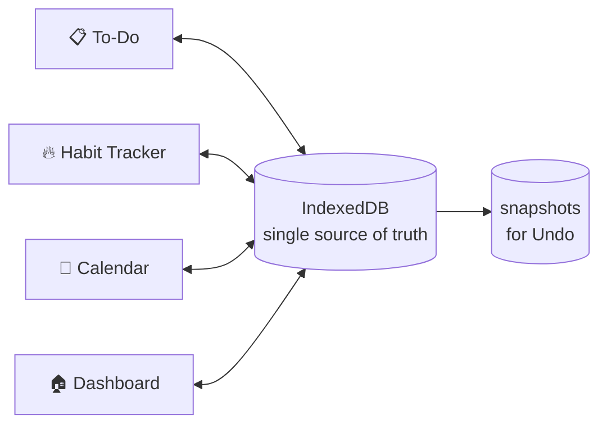

# 🧠 My Workspace

> A clean, private, local-first personal productivity workspace that brings **tasks, calendar, and habits** into one app with **no backend, no cloud, and no login**.

This README is both the **project documentation** and a **build prompt**. Anyone (or any AI coding assistant) reading it top to bottom should be able to build V1 without guessing. Where the spec leaves a gap, the [Decisions Log](#-17-decisions-log--open-questions) records the choice made.

---

## 📑 Table of Contents

1. [Overview](#-1-overview)
2. [Quick Facts](#-2-quick-facts)
3. [How Everything Connects](#-3-how-everything-connects)
4. [Navigation & Layout](#-4-navigation--layout)
5. [Module 1: Dashboard](#-5-module-1-dashboard)
6. [Module 2: To-Do](#-6-module-2-to-do)
7. [Module 3: Calendar](#-7-module-3-calendar)
8. [Module 4: Habit Tracker](#-8-module-4-habit-tracker)
9. [Theme & Design System](#-9-theme--design-system)
10. [Global Features & Data Safety](#-10-global-features--data-safety)
11. [Keyboard Shortcuts](#-11-keyboard-shortcuts)
12. [Data Model (IndexedDB)](#-12-data-model-indexeddb)
13. [Scope: V1 vs Later](#-13-scope-v1-vs-later)
14. [Development Roadmap & Acceptance Criteria](#-14-development-roadmap--acceptance-criteria)
15. [How to Use the App](#-15-how-to-use-the-app)
16. [Build Prompt (for Developers & AI Assistants)](#-16-build-prompt-for-developers--ai-assistants)
17. [Decisions Log & Open Questions](#-17-decisions-log--open-questions)

---

## 🎯 1. Overview

**Product type:** Personal, local-first productivity application
**Runs in:** Google Chrome
**Core philosophy:** *Minimal interface + powerful functionality + complete data ownership.*

### Objectives
1. ⚡ Capture and organize tasks with almost no friction.
2. 📋 Separate work into dedicated **Pages**.
3. 📅 See tasks, habits, and events in **one calendar**.
4. 🔥 Track habits and long-term consistency.
5. 🎨 Keep a clean, Google-inspired interface.
6. 🔒 Store all personal data locally.
7. 🛡️ Prevent accidental data loss with Undo and backups.

### Non-negotiable principles
1. **Simplicity:** Never add a feature just because it looks advanced.
2. **Privacy:** Personal data stays local. No backend or cloud dependency.
3. **Data safety:** Users can recover from mistakes and export everything.
4. **Consistency:** All modules share one design language.
5. **Integration:** Tasks, habits, and events work together with no duplicate records.
6. **Speed:** Common actions need minimal clicks.
7. **User control:** Users control Pages, colors, ordering, filters, and themes.
8. **Reliability:** Correct data handling matters more than visual effects.

---

## ⚙️ 2. Quick Facts

| Area | Decision |
|---|---|
| Frontend | React |
| Language | JavaScript or TypeScript (TypeScript recommended) |
| Styling | CSS or Tailwind CSS |
| Database | IndexedDB (single local source of truth) |
| Runtime | Google Chrome (latest) |
| Backend | None |
| Cloud | None |
| Authentication | None |
| Network | No application network calls |
| Themes | Light and Dark |
| Data updates | Instant UI updates (optimistic) |

---

## 🔗 3. How Everything Connects

The four modules are **views over one shared database**. No module keeps its own copy of a task or habit.



### Connection map

| Module | Reads | Writes |
|---|---|---|
| **Dashboard** | pages, tasks, habits, habitLogs, events | Task checkbox, habit check, quick add task/habit |
| **To-Do** | pages, tasks | Pages, tasks, order, archive state |
| **Calendar** | tasks (dueDate), habits, habitLogs, events, dayColors | Events, dayColors, view settings |
| **Habit Tracker** | habits, habitLogs | Habits, habitLogs |
| **Settings** | settings | Theme, week start, display name, backups |

### Example: one checkbox, many updates

You tick **"Finish project documentation"** on the Dashboard. That single write to the `tasks` record instantly updates:

- ✅ The Dashboard "Tasks 6 / 10" counter and Today's Tasks list.
- ✅ The **Projects** Page card (progress bar and pending preview).
- ✅ The **Calendar** cell for that task's due date (strike-through).
- ✅ The **Upcoming** list and Weekly Progress.
- ✅ The **Undo** snapshot.

**Rule:** If the same fact appears in two places, both places read from the same record. Derived numbers (counts, percentages, streaks) are **computed**, never stored or hardcoded.

### Cross-module links
- Dashboard item → opens its original To-Do Page or Calendar event.
- Calendar task → opens its To-Do Page with the task highlighted.
- Calendar habit → opens its Habit Tracker row.
- Calendar event → opens the event editor.

---

## 🧭 4. Navigation & Layout

The app has **exactly four primary sections**, shown in a consistent left sidebar:

| Section | Subtitle | Purpose |
|---|---|---|
| 🏠 Dashboard | Overview | Today at a glance |
| 📋 To-Do | Tasks & Pages | Manage work by area |
| 📅 Calendar | Planning | See everything by date |
| 🔥 Habit Tracker | Consistency | Track daily habits |

**Not sidebar items:**
- **Career, Projects, Learning, Personal** are *Pages inside To-Do*, not navigation items.
- **Settings** opens from a ⚙️ gear icon in the top header. This keeps the sidebar at exactly four sections.

### Layout

```
┌──────────────┬───────────────────────────────────────────────┐
│ My Workspace │ [🔍 Search  Ctrl+K]        [📅 date] [🔔] [☀️/🌙]│
│              ├───────────────────────────────────────────────┤
│ 🏠 Dashboard │                                               │
│ 📋 To-Do     │            Active module content              │
│ 📅 Calendar  │                                               │
│ 🔥 Habits    │   (To-Do shows its own Page list on the left) │
│              │                                               │
│ ⚙️ (header)  │                                               │
└──────────────┴───────────────────────────────────────────────┘
```

### Header (top-right, every screen)
- Global search (Ctrl/Cmd + K)
- Current date
- Notifications bell (optional in V1; hide if not implemented)
- Single Light/Dark toggle: ☀️ sliding to 🌙
- ⚙️ Settings

### Responsive behavior
- **Desktop (≥1024px):** Full sidebar.
- **Tablet (768–1023px):** Collapsible sidebar.
- **Mobile (<768px):** Bottom navigation with the four sections. To-Do Pages become a horizontal scroll row.

---

## 🏠 5. Module 1: Dashboard

**Purpose:** Answer five questions in under ten seconds:
1. What should I do today?
2. What tasks are pending?
3. How are my habits going?
4. What events are coming up?
5. What is my overall progress?

### 5.1 Components

| Component | What it shows | Source and rule |
|---|---|---|
| **Welcome** | "Good morning/afternoon/evening, {name}" and date | Name from settings. Greeting by local time. |
| **Tasks card** | `completed / total` | Tasks **due today**. Total = due today; completed = those checked. |
| **Habits card** | `completed / scheduled` today | Only habits scheduled for today. |
| **Events card** | Count of events today | `events` where date = today. |
| **Pages card** | Count of active Pages | Non-archived pages. |
| **Today's Tasks** | Top 3 items + Add Task button | See 5.2. |
| **Habit Summary** | Today's habits as checkboxes, `%` | See 5.3. |
| **Upcoming** | Next 7 days of tasks and events | See 5.4. |
| **Weekly Progress** | Tasks, habits, events for this week | Current week, Monday to Sunday (see Decisions). |

### 5.2 Today's Tasks
- Includes incomplete tasks that are **due today**, **overdue**, or **High priority**.
- Sort: overdue first, then High > Medium > Low, then manual order.
- Shows the top **3**. A "View all" link opens To-Do.
- Checkbox completes the task with strike-through and Undo toast.
- Clicking a task title opens its Page with the task highlighted.
- **Add Task** button below the list. Opens an inline form with a Page dropdown (defaults to the last-used Page).

### 5.3 Habit Summary
- Shows today's **scheduled** habits only.
- Each habit is a checkbox. Ticking it writes a `habitLogs` record.
- `+` button in the top-right opens the **Add Habit** form.
- Footer shows `4 / 5 · 80%`.
- If nothing is scheduled today: "No habits scheduled today."

### 5.4 Upcoming
- Next **7 days**, starting today.
- Includes incomplete tasks with a due date and all events.
- Each item shows date, name, and its category color.
- Click opens the original record.

### 5.5 Weekly Progress
- Ring showing overall percentage: `(completed tasks + completed habit days + events attended?) ...` → **simplified rule:** `(tasks completed this week + habit completions this week) / (tasks due this week + habit occurrences this week) × 100`.
- Legend lists Tasks, Habits, and Events counts.
- Events are shown as a count only and are not part of the percentage.

### 5.6 Dashboard rules
- ❌ No artificial productivity scores.
- ❌ No Quick Actions sidebar. Add actions live inside their sections.
- ❌ No analytics beyond the components above.
- ✅ Every number is computed from data.

---

## 📋 6. Module 2: To-Do

**Highest development priority.** Built first after the foundation.

**Model:** Tasks belong to exactly **one Page**. Filters only *view* tasks; they never move or copy them.

### 6.1 Pages

A Page is a container for tasks, such as Career, Projects, Learning, or Personal.

| Action | Behavior |
|---|---|
| Create | Name required (unique, max 40 chars). Icon and color optional. |
| Rename | Inline edit. |
| Reorder | Drag cards. Order saved in `pages.order`. |
| Set icon | Choose from a small built-in icon set. |
| Set color | Choose from a palette (see Calendar colors). |
| Archive | Hides the Page and its tasks. Data kept. |
| Restore | Brings an archived Page back, same tasks and order. |
| Permanent delete | Requires typing the exact Page name (see 6.8). |

**Initial Pages (all editable, deletable, renamable):**

| Page | Example content |
|---|---|
| Career | Internships, jobs, resume, DSA |
| Projects | Development tasks, bugs, deployment |
| Learning | Courses, concepts, exam prep |
| Personal | Exercise, reading, personal goals |

### 6.2 Page overview cards (the "see without opening" feature)

Each Page card on the To-Do landing screen shows:

- Icon, name, and color accent.
- Total tasks and completed count (e.g. `8 tasks · 2 done`).
- Completion percentage and progress bar.
- **Up to 5 pending task previews**, ordered by:
  1. Incomplete High-priority tasks
  2. Other incomplete tasks, by manual order
- Priority tag on each preview.
- Checkbox per preview (where practical).
- Completed tasks are **never** in the preview.
- Clicking the card opens the Page view.

### 6.3 Page view

- Full task list for that Page.
- Secondary navigation **inside the To-Do section** (left column): Career, Projects, Learning, Personal, custom Pages, and **Archived**. This list never sits in the main sidebar.
- Progress for the Page.
- Filter bar (6.5).
- Add Task control at the top and bottom.
- Edit and delete on each task.

### 6.4 Tasks

| Field | Type | Notes |
|---|---|---|
| `id` | string (UUID) | Unique |
| `pageId` | string | Required. Exactly one Page. |
| `title` | string | Required, max 200 chars |
| `priority` | `high` / `medium` / `low` | Default `medium` |
| `important` | boolean | Star toggle |
| `completed` | boolean | Checkbox |
| `completedAt` | timestamp or null | Set on completion |
| `dueDate` | `YYYY-MM-DD` or null | Optional deadline |
| `order` | number | Manual order within the Page |
| `createdAt`, `updatedAt` | timestamp | Consistent across all records |

**Task actions:**

| Action | Behavior |
|---|---|
| Create | Title required. Other fields optional. |
| Edit | Title, priority, important, due date, Page. |
| Complete / uncomplete | Checkbox. Strike-through when complete. |
| Star (important) | Toggle. |
| Move to another Page | Edit Page field. Keeps order at the end of the target Page. |
| Reorder | Drag-and-drop within a Page. |
| Delete | Immediate, with **Undo toast** (6–7 seconds). |
| Serial number | Display number (1, 2, 3…) based on current order. |

**Overdue:** `dueDate < today` and not completed. Shown with a red date badge.

### 6.5 Filters

| Filter | Shows |
|---|---|
| **All Tasks** | Every task in the current scope |
| **Open** | Incomplete tasks |
| **Important ⭐** | Starred tasks |
| **Completed** | Completed tasks |
| **Today** | Tasks due today |

**Rules:**
- Filters are scoped to the current view (a Page, or all Pages on the landing screen).
- Overdue tasks appear in **Today** as well as **Open**.
- Filters combine with search.
- Incomplete tasks always sit above completed tasks.

### 6.6 Sorting rules

1. Incomplete before completed.
2. Within incomplete: overdue first, then High > Medium > Low, then `order`.
3. Within completed: most recently completed first.

Priority is shown as a **tag and sort key**, not a separate tab.

### 6.7 Search
- `Ctrl/Cmd + K` opens global search.
- Searches task titles and Page names across **all** Pages, including archived Pages (marked as archived in results).
- Results grouped by Page. Selecting a result opens it with the task highlighted.

### 6.8 Page deletion safety (three stages)

1. **Archive:** Page disappears from the active list and moves to **Archived**. Nothing is deleted.
2. **Restore:** Brings it back exactly as it was.
3. **Permanent delete:** Only available from the Archived view.
   - Shows the number of tasks that will be removed.
   - Explains that the Page and all its tasks will be deleted.
   - User must type the **exact Page name** to enable the Delete button.
   - Creates a recovery snapshot first (see Section 10).

---

## 📅 7. Module 3: Calendar

**Purpose:** One visual calendar showing tasks, habits, and events together.

**Key requirement:** Activity **names** appear directly inside date boxes, not just colored dots.

### 7.1 Views

| View | Layout |
|---|---|
| **Month** | Grid of boxes, each with date number and activity names |
| **Week** | Seven columns with more space per day |
| **Day** | Vertical schedule for one date |

No Year view in V1.

**Day view details:**
- Items with a time are placed chronologically on a timeline.
- Items without a time appear in an **All-day** section at the top.
- Clicking a date in Month or Week and choosing Day opens its schedule.

### 7.2 Date boxes (Month and Week)

Each date box contains:
- Date number.
- Activity names with their category color indicator.
- Selected-date highlight (blue outline).
- Custom background color, if set (see 7.5).

**Overflow:** Show up to **3 labels**, then `+N more`. Clicking `+N more` opens the Day view for that date. Never hide everything, and never overcrowd the cell.

### 7.3 Activity sources

| Category | Source | Calendar behavior |
|---|---|---|
| **To-Do** | Tasks with a `dueDate` | Shown on due date. Strike-through when complete. |
| **Habits** | Habits scheduled for that weekday | Shown on scheduled dates. Checked state from `habitLogs`. |
| **Events** | Events created in Calendar | Shown on their date and time. |

**Important:** Calendar **reads** from the source records. It never creates copies. Editing a task's due date in To-Do moves it on the Calendar automatically.

### 7.4 Category colors

Colors identify the **type** of activity. They are customizable.

| Activity | Default color | Customizable via |
|---|---|---|
| Each To-Do Page | Page color (Career blue, Projects green, Learning purple, Personal pink) | Page settings |
| Habits | Teal (see Decisions) | Habit settings |
| Events | Orange | Event settings |

Category legend sits in the Calendar side panel with an edit (✏️) button.

### 7.5 Day background colors

Users can change the **entire background** of an individual date.

- Example: Nov 2 → blue, Nov 3 → green, Nov 4 → yellow.
- Stored in the `dayColors` store (see Section 12).
- **Independent of category colors.** One is the day's *mood or marker*; the other is the activity's *type*.
- Set from the date's context menu or the Day view.
- A palette of 6–8 soft colors plus "No color" (remove).

### 7.6 Calendar controls

| Control | Behavior |
|---|---|
| ◀ ▶ | Previous / next month (or week, or day, depending on view) |
| Today | Jump to today |
| Month / Week / Day | View selector |
| To-Do toggle | Show or hide task activities |
| Habits toggle | Show or hide habit activities |
| Events toggle | Show or hide events |
| Show completed | Show or hide completed items |
| Category editor | Change category colors |
| Day color | Change a date's background |

### 7.7 Interactions

| Click on | Result |
|---|---|
| Task | Opens its To-Do Page with the task highlighted |
| Habit | Opens its Habit Tracker row |
| Event | Opens the event editor |
| Empty area of a date | Opens **Create Event** for that date |
| `+N more` | Opens Day view |

**Events CRUD:** Create, edit, delete (with Undo). Fields: title, date, optional start time, optional end time, color, category (default: Event / Meeting).

---

## 🔥 8. Module 4: Habit Tracker

**Purpose:** Track daily habits and see long-term consistency.

Three visual modes, switchable from the header.

### 8.1 Habit definition

| Field | Type | Notes |
|---|---|---|
| `id` | string | Unique |
| `name` | string | Required, max 60 chars |
| `icon` | string | Built-in icon set |
| `color` | string | Calendar and card accent. Default teal. |
| `schedule` | `{ type: 'daily' }` or `{ type: 'weekdays', days: [1,3,5] }` | Monday = 1, Sunday = 7 |
| `createdAt`, `updatedAt` | timestamp | |

**Schedules (V1):**
- **Every day**
- **Selected weekdays** (for example, Exercise Monday to Saturday, Reading daily)

**Only scheduled dates count** toward streaks and completion percentages. An unscheduled day is neither a success nor a miss.

### 8.2 Habit logs

One record per **habit + date**, with `completed: true | false`. Unique key: `habitId + date`. Ticking a box creates or updates the record. Unticking updates it to `false`. Blank = not yet decided.

### 8.3 Template 1: Table (primary view)

Habits as rows, dates as columns.

| Habit | Mon | Tue | Wed | Thu | Fri | Streak | Progress |
|---|---|---|---|---|---|---|---|
| Exercise | ✅ | ✅ | ✅ | ❌ | ✅ | 12d | 86% |
| Reading | ✅ | ✅ | ❌ | ✅ | ✅ | 8d | 71% |

- Week view (default) and Month view.
- Daily checkbox per cell.
- Unscheduled cells show a dash (–), not an empty box.
- Streak and completion % per row.
- Add, edit, delete habits from the row menu.

### 8.4 Template 2: Card view

One card per habit:

```
┌──────────────────────┐
│ 💪 Exercise           │
│        86%            │
│ 24 / 28 completed     │
│ Missed: 4             │
│ 🔥 12-day streak      │
│ Longest: 15 days      │
│ [weekly activity bars]│
└──────────────────────┘
```

Each card shows: name and icon, completion %, completed count, missed count, current streak, longest streak, and a small graph of frequency (weekly or monthly).

### 8.5 Template 3: Heatmap (common overview)

- One grid for **all habits combined**.
- Each cell is one day. Darker green = more habits completed that day.
- Cell intensity = `completed scheduled habits ÷ scheduled habits that day`.
  - No scheduled habits: muted/empty.
  - 0%: empty.
  - 1–49%: light.
  - 50–99%: medium.
  - 100%: dark.
- Shows monthly and yearly history when data exists.
- Overall consistency % in the corner.

### 8.6 Streak and percentage rules

**Current streak:**
- Count consecutive **scheduled** days completed, going backward from today.
- Skip unscheduled days.
- If today is scheduled but not yet completed, the streak is **not broken**. It counts from yesterday.

**Longest streak:** Maximum consecutive completed scheduled days ever recorded.

**Completion % (per habit):** `completed scheduled days ÷ scheduled days` in the selected period (default: last 28 days).

**Overall consistency:** `total completed scheduled habit-days ÷ total scheduled habit-days` in the selected period.

### 8.7 Habit management

- Create, edit name and icon and color and schedule, delete.
- Deleting a habit asks for confirmation and removes its logs. Undo is available for 7 seconds.
- Historical completion can be viewed and corrected for any past scheduled date.

---

## 🎨 9. Theme & Design System

**Direction:** Google-inspired clean UI with a minimal personal feel. Not an enterprise dashboard.

### 9.1 Color tokens

| Token | Light | Dark |
|---|---|---|
| Main background | `#F7FAFF` | `#202124` |
| Card background | `#FFFFFF` | `#303134` |
| Primary blue | `#4285F4` | `#8AB4F8` |
| Primary text | `#202124` | `#E8EAED` |
| Secondary text | `#5F6368` | `#BDC1C6` |
| Border | `#E8EAED` | `#45474A` |

Define these as **CSS variables** on `:root`, overridden by a `data-theme` attribute. This makes new colors and dark mode changes a one-line edit.

### 9.2 Theme toggle
- One sliding switch in the header.
- ☀️ Light on the left, 🌙 Dark on the right.
- Smooth transition (150–200ms).
- Preference saved in `settings`.
- Layout identical in both themes.
- ❌ No separate preview pages or duplicate buttons.

### 9.3 UI principles
- Rounded cards (12–16px radius).
- Soft 1px borders, limited shadows.
- One spacing scale (4, 8, 12, 16, 24, 32).
- One accent color (primary blue) for actions.
- Clear icons, good contrast (WCAG AA minimum).
- Minimal animation, respects `prefers-reduced-motion`.
- Visible focus states for keyboard users.

---

## 🛡️ 10. Global Features & Data Safety

These apply everywhere.

| Feature | Behavior |
|---|---|
| **Undo** | Reverses the last action (toast button, or Ctrl/Cmd + Z). |
| **Snapshots** | Before-state of every change stored in `snapshots`. Keeps the last **30** actions; older ones are pruned. |
| **Undo toast** | Shown for ~6 seconds after deletes and bulk changes. |
| **Archive** | Hides a Page without deleting data. |
| **Safe permanent delete** | Requires typing the exact name. Snapshot created first. |
| **Optimistic updates** | UI updates immediately. If the write fails, the UI rolls back and shows an error. |
| **Persistent storage** | All writes go to IndexedDB. Data survives browser restarts. |
| **Error handling** | Storage and import errors shown clearly. Never silent. |
| **Schema versioning** | IndexedDB version number with migration functions. |

### 10.1 JSON export

Settings → **Export backup** downloads one file:

```json
{
  "app": "my-workspace",
  "schemaVersion": 1,
  "exportedAt": "2026-11-01T09:30:00+05:30",
  "data": {
    "pages": [],
    "tasks": [],
    "habits": [],
    "habitLogs": [],
    "events": [],
    "dayColors": [],
    "settings": {}
  }
}
```

Includes: pages, tasks, habits, habit logs, events, custom colors, day background colors, theme, settings, and schema version.

**Backup reminder:** Settings shows "Last backup: {date}". If older than 7 days, show a gentle banner.

### 10.2 JSON import

1. **Validate:** File parses, `app` matches, required arrays exist, each record has an `id`.
2. **Check version:** `schemaVersion` must be ≤ the app's supported version.
3. **Preview:** Show counts (e.g. "12 tasks, 3 pages, 40 habit logs").
4. **Choose mode:**
   - **Merge:** Insert or update by `id`. Existing records not in the file are kept.
   - **Replace:** Clears current data and loads the file.
5. **Confirm.**
6. **Safety copy:** Before Replace, automatically download a backup of current data.
7. **Import in one transaction**, then verify counts.

### 10.3 Privacy and storage limits

- IndexedDB can be **lost** if the user clears Chrome site data, deletes the profile, or hits storage problems.
- It offers **no protection** against someone with access to the unlocked device.
- **Frequent JSON exports are essential.** This is stated in the in-app Settings screen, not hidden.

---

## ⌨️ 11. Keyboard Shortcuts

| Shortcut | Action |
|---|---|
| `Ctrl/Cmd + K` | Global search |
| `N` | New task (in To-Do context) |
| `Ctrl/Cmd + Z` | Undo last action |
| `Esc` | Close modal or cancel active interaction |

**Rule:** Single-key shortcuts (like `N`) fire **only when focus is not in a text field**.

---

## 🗄️ 12. Data Model (IndexedDB)

### 12.1 Object stores

| Store | Key | Main fields | Indexes | Responsibility |
|---|---|---|---|---|
| `pages` | `id` | name, icon, color, order, archived, createdAt, updatedAt | `order` | Page management |
| `tasks` | `id` | pageId, title, priority, important, completed, completedAt, dueDate, order, createdAt, updatedAt | `pageId`, `dueDate`, `[pageId+order]` | Tasks |
| `habits` | `id` | name, icon, color, schedule, createdAt, updatedAt | — | Habit definitions |
| `habitLogs` | `id` | habitId, date, completed, updatedAt | `date`, `[habitId+date]` (unique) | Habit history |
| `events` | `id` | title, date, startTime, endTime, color, category, createdAt, updatedAt | `date` | Calendar events |
| `dayColors` | `date` | color | — | Custom date backgrounds *(added in this README; the original spec had no store for it)* |
| `settings` | `key` | value | — | Theme, week start, display name, last backup |
| `snapshots` | `id` (auto) | timestamp, action, records (before-state) | `timestamp` | Undo and recovery |

### 12.2 Rules
- Use **UUIDs** for ids.
- Store dates as `YYYY-MM-DD` strings (local time). Store timestamps as ISO 8601.
- Use **transactions** for any change that touches more than one record (reorder, page delete, import).
- Every write updates `updatedAt`.
- Migrations are written before a schema change is shipped.

---

## 📦 13. Scope: V1 vs Later

### ✅ V1

| Area | Included |
|---|---|
| Dashboard | Full overview (5.1 to 5.5) |
| To-Do | Page CRUD, page cards, page view, task CRUD, priority, important, filters, ordering, archive, restore, safe delete |
| Calendar | Month, Week, Day views; activity names in boxes; category colors; day backgrounds; visibility toggles; events CRUD |
| Habit Tracker | Table, Card, Heatmap; schedules; streaks; graphs; history |
| Global | Undo, snapshots, JSON export and import, schema versioning, dark and light mode, keyboard shortcuts |

### ⏳ Later

- Advanced analytics
- Cross-device sync
- Cloud backups
- Additional habit templates
- Advanced automation
- Year view for Calendar
- Notes and thoughts capture *(not in this spec; see Decisions)*

---

## 🚀 14. Development Roadmap & Acceptance Criteria

**Do not build all modules at once.** Finish each phase before starting the next.

### Phase 1: Foundation
Build: React setup, routing, IndexedDB with schema versioning, theme system, shared components.

✅ **Done when:** App loads, theme toggles and persists, IndexedDB opens with version 1, a test record survives a browser restart.

### Phase 2: To-Do
Build: Page CRUD, task CRUD, priority, important, filters, ordering, page cards, archive, restore, Undo.

✅ **Done when:**
- A Page can be created, renamed, reordered, archived, restored.
- Tasks move between Pages without losing data.
- Page cards show correct counts and top 5 pending previews.
- Permanent delete requires the exact name and creates a snapshot.
- Undo restores a deleted task.

### Phase 3: Dashboard
Build: Tasks card, habits card, events card, pages card, Today's Tasks, Habit Summary, Upcoming, Weekly Progress.

✅ **Done when:** Every number matches its source records. Ticking a task here updates To-Do and Calendar.

### Phase 4: Calendar
Build: Month, Week, Day views, activity integration, category colors, day backgrounds, visibility toggles, events CRUD.

✅ **Done when:** Editing a task's due date in To-Do moves it on the Calendar. Day view orders timed items and shows all-day items separately. `+N more` works.

### Phase 5: Habit Tracker
Build: Table, Card, Heatmap, schedules, streaks, completion %, history.

✅ **Done when:** Unscheduled days are excluded from streaks and percentages. Streak rules in 8.6 pass hand-checked examples.

### Phase 6: Data Safety
Build: JSON export and import (merge and replace), recovery snapshots, safe deletion, migrations, error handling.

✅ **Done when:** Export → clear site data → import restores everything exactly. A corrupted or wrong-version file is rejected with a clear message.

### Phase 7: Testing & Polish
Build: Responsive layouts, accessibility, performance, keyboard navigation, real-world testing.

✅ **Done when:** Core flows work on mobile and desktop, with keyboard only, and in both themes. The app is used daily for 14 consecutive days.

---

## 🧑‍💻 15. How to Use the App

### 🌅 Daily routine (about 3 minutes)

1. **Open Dashboard.** Check Today's Tasks and the Habit Summary.
2. **Tick habits** as you finish them.
3. **Open To-Do** when you need to plan. Add tasks to the right Page.
4. **Check Calendar** once a week to see what's coming.
5. **Review Habit Tracker** on Sundays. Look at streaks and the heatmap.
6. **Export a backup** every week from Settings.

### 📋 To-Do: how to use each part
- **Pages overview:** Scan which areas have pending work. Use the preview checkboxes for quick wins.
- **Page view:** Plan the full list. Star the 1–3 tasks that matter most.
- **Archived:** Park a Page you're not using. Restore it later.

### 📅 Calendar: how to use it
- **Month:** See the shape of the month. Use `+N more` to drill in.
- **Week:** Plan your week's load.
- **Day:** Plan a specific day in detail. Use all-day items for deadlines.
- **Day colors:** Mark special days, such as exam days or travel.
- **Toggles:** Hide habits when you only want tasks, or hide completed items to reduce noise.

### 🔥 Habit Tracker: how to use each view
- **Table:** Daily check-in. Fastest for logging.
- **Card:** Review one habit's health in depth.
- **Heatmap:** Look at the big picture. Spot weak weeks.

---

## 🤖 16. Build Prompt (for Developers & AI Assistants)

Use the following as the instruction set when handing this README to a developer or AI coding assistant.

```
You are building "My Workspace", a local-first personal productivity app.

HARD CONSTRAINTS
- React (JS or TS) + CSS or Tailwind. Target Google Chrome.
- All data in IndexedDB. No backend, no auth, no cloud, no analytics,
  no network calls except loading the app itself.
- Exactly four primary navigation sections: Dashboard, To-Do, Calendar,
  Habit Tracker. Settings opens from a header gear icon.
- Career, Projects, Learning, Personal are To-Do Pages, not nav items.
- Do NOT add features outside this README. If something is unclear,
  choose the simplest option and record it in the Decisions Log.

BUILD ORDER
1. Foundation (React, IndexedDB + schema versioning, theme)
2. To-Do (Pages, Tasks, filters, archive, Undo)
3. Dashboard (computed summaries only)
4. Calendar (reads from tasks, habits, events)
5. Habit Tracker (table, card, heatmap)
6. Data safety (export, import, snapshots)
7. Polish (responsive, a11y, keyboard)

DATA RULES
- One source of truth. Never duplicate tasks or habit records.
- Every number on screen is computed from data, never hardcoded.
- Use transactions for multi-record changes.
- Every write updates updatedAt. Dates are YYYY-MM-DD local.

UX RULES
- Undo for every delete. Confirm only permanent deletes.
- Optimistic UI updates with rollback on error.
- Keyboard shortcuts never fire while typing.
- Light and dark themes with identical layout.

DEFINITION OF DONE (per phase)
- Acceptance criteria in Section 14 pass.
- No console errors. No data loss on reload.
- Works after closing and reopening Chrome.

OUTPUT
- Code with brief reasoning on key decisions.
- Note any assumption in the Decisions Log.
```

---

## 🧾 17. Decisions Log & Open Questions

### ✅ Decisions made in this README

| # | Topic | Decision | Why |
|---|---|---|---|
| D1 | Habit color | Teal | Projects already uses green; avoid clashing colors in the Calendar |
| D2 | Week start | Monday | Matches the Weekly Progress and Habit grid; configurable later |
| D3 | Settings location | ⚙️ header icon | Keeps exactly four sidebar sections, as the spec requires |
| D4 | Day background storage | `dayColors` store | The original spec had no place to save custom date colors |
| D5 | Habit streak rule | Unscheduled days skipped; today not penalized until day ends | Prevents false streak breaks |
| D6 | Snapshot retention | Last 30 actions | Enough for real recovery, small enough to stay fast |
| D7 | Weekly Progress formula | Tasks plus habits only; events shown as count | Events are not work items to complete |
| D8 | Undo keyboard | Ctrl/Cmd + Z | Standard expectation |

### ❓ Open questions (decide before Phase 2)

| # | Question | Options |
|---|---|---|
| Q1 | App name | "My Workspace" (this spec) or "Personal Space" (earlier notes) |
| Q2 | Notes and thoughts capture | Out of V1 per this spec, or add a fifth module? |
| Q3 | Page icon set | Use a library, or a fixed set of about 20 icons? |
| Q4 | Mobile priority | Desktop-first, or mobile layout in Phase 2? |

---

## 🚫 Non-Goals (V1)

- Not a team tool. No sharing, comments, or assignments.
- Not a sync tool. One browser, one device.
- Not an analytics dashboard. No scores or charts beyond the ones listed.
- Not a replacement for Google Calendar. Calendar here is for planning within this app.

---

> **Final goal:** A personal workspace that makes daily organization easier, keeps all personal data under the user's control, and stays simple enough to open every day. 🎯
